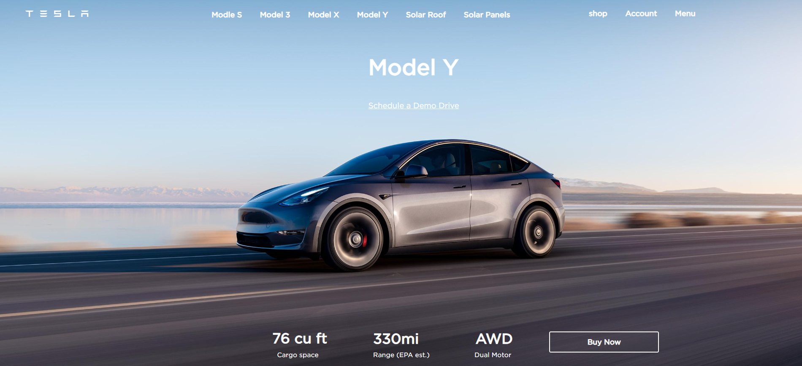

# Tesla Model Y Landing Page

A static landing page inspired by the Tesla Model Y product page, built with plain **HTML and CSS** as a front-end practice project.



## Features

- Full-width hero section with a Model Y background image
- Navigation bar with the logo and model links (Model S, 3, X, Y, Solar Roof, Solar Panels)
- Account links: Shop, Account, Menu
- Key specs section: 76 cu ft cargo space, 330 mi range (EPA est.), AWD dual motor
- "Schedule a Demo Drive" link and a **Buy Now** button
- Hover effects: the Buy Now button fills white with a smooth transition, and nav items get a soft highlight
- Custom **Gotham** font loaded with `@font-face`
- Custom favicon

## Built with

- HTML5
- CSS3 (no JavaScript, no frameworks)

## Project structure

```
tesla-model-y-landing-page/
├── index.html        # Page structure and content
├── style.css         # All styling, layout and hover effects
├── background.jpeg   # Hero background image
├── logo.svg          # Logo in the top-left corner
├── icon.ico          # Browser tab icon (favicon)
├── Gotham.woff2      # Custom font
├── screenshot.png    # Preview image used in this README
└── README.md
```

## How to run

1. Download or clone this repository:
   ```
   git clone https://github.com/YOUR-USERNAME/tesla-model-y-landing-page.git
   ```
2. Open the folder.
3. Double-click `index.html` to open it in your browser. No installation or server is needed.

For the best view, open it on a desktop screen around **1440 px wide**.

## Deploy for free with GitHub Pages

1. Push the project to a GitHub repository.
2. Go to **Settings > Pages**.
3. Under **Branch**, choose `main` and `/ (root)`, then click **Save**.
4. After a minute your site will be live at `https://YOUR-USERNAME.github.io/tesla-model-y-landing-page/`.

## Known limitations

- The layout uses fixed pixel positions, so it is designed for desktop screens and is **not yet responsive** on tablets or phones.
- It is a single static page, so the navigation links do not go anywhere.

## Ideas for improvement

- Make the layout responsive with Flexbox/Grid and media queries
- Replace pixel margins with Flexbox for the navigation and specs bar
- Add a mobile menu
- Add more sections (features, gallery, pricing)
- Add scroll animations with JavaScript

## What I learned

- Structuring a page with semantic HTML and lists
- Styling with CSS: positioning, typography, `@font-face`, background images
- Creating hover effects and transitions

## Disclaimer

This is an educational, non-commercial practice project. Tesla, the Tesla logo, the Model Y name and related images are trademarks and property of Tesla, Inc. This project is not affiliated with or endorsed by Tesla. The Gotham font is a commercial typeface owned by its respective licensor; if you reuse this project, make sure you have the right to use it, or replace it with a free alternative such as Montserrat.

## Author

**W.M. Tharindu Nadeeshan Wijesekera**
Badulla, Sri Lanka
LinkedIn: [linkedin.com/in/tharindu-w-81156a334](https://linkedin.com/in/tharindu-w-81156a334)
